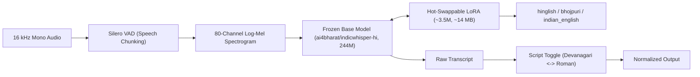

---
language:
- hi
- en
license: mit
library_name: peft
base_model: ai4bharat/indicwhisper-hi
tags:
- automatic-speech-recognition
- whisper
- lora
- peft
- hindi
- hinglish
- indian-english
- speech
- audio
datasets:
- ai4bharat/IndicVoices
- mozilla-foundation/common_voice_17_0
metrics:
- wer
- cer
pipeline_tag: automatic-speech-recognition
---

<div align="center">

<!-- Laila Logo URL top view (Upar wala logo) -->


### Parameter-Efficient Adaptation of IndicWhisper / Whisper-Small for Indian-Accented and Code-Switched Hindi-English Speech

[](https://github.com/techindro)
[](https://huggingface.co/techindro/Laila)
[](https://opensource.org/licenses/MIT)
[](https://www.python.org/downloads/)
[](https://pytorch.org/)
[](https://huggingface.co/docs/transformers)
[](https://github.com/huggingface/peft)
[](https://neurips.cc)

**3.5M trainable params · 1.5% of base model · Trains on 1 free T4 GPU**

</div>

---

## 🌐 Platform Overview


> *"Whisper, but for India — parameter-efficient ASR for Indian-accented and code-switched speech"*

Laila provides high-quality speech recognition, model evaluation, and AI tools designed for Indian users, enterprises, and researchers working on next-generation voice applications. Built on `ai4bharat/indicwhisper-hi` (~244M frozen parameters, with fallback compatibility to `openai/whisper-small`), Laila adapts all 72 encoder/decoder attention layers using LoRA (`r=32`, `lora_alpha=64`, `q_proj` & `v_proj`).

---

## 🏗️ Architecture Overview



---

## 🚀 Live Demos

Experience Laila in action. All demos run on Hugging Face Spaces — no installation required.


| Demo | Description | Link |
|------|-------------|------|
| 🎙️ Hindi ASR | Hindi speech recognition with LoRA-tuned IndicWhisper | [Try Now](https://huggingface.co/spaces/techindro/Laila-Demo) |
| 🔀 Hinglish ASR | Code-switched Hindi-English transcription | [Try Now](https://huggingface.co/spaces/techindro/Laila-Hinglish) |
| 🇮🇳 Indian English ASR | Indian-accented English transcription | [Try Now](https://huggingface.co/spaces/techindro/Laila-IndianEnglish) |
| 🌐 22-Language Suite | One adapter per scheduled Indian language | [Coming Soon](https://huggingface.co/techindro) |

🌐 Repository: [github.com/techindro/Laila](https://github.com/techindro/Laila)

---

## 📖 What is Laila?

Laila is a **parameter-efficient speech recognition model** purpose-built for India's linguistic diversity. It adapts the frozen `ai4bharat/indicwhisper-hi` (Whisper-Small architecture) model using LoRA, training only **1.5% of parameters** while keeping all 244M base weights frozen.

### The Name

- **Laila** = "Night" in Arabic/Persian, "play" in Hindi — evoking speech and expression
- **Model** = Speech recognition for Indian languages

So Laila means bringing clarity to Indian speech, day or night.

### What Problem Does It Solve?

Global speech models like Whisper, trained mostly on Western English, make more errors on Indian speech because:

1. Indian-accented English has different phonetics, rhythm, and stress patterns
2. Everyday speech is often code-switched (Hindi + English in one sentence)
3. No single accepted transcript convention exists (Devanagari vs. Roman)
4. Full fine-tuning is costly — needs more memory and produces full model copies

**The result:** Speech recognition that works perfectly in San Francisco but struggles in Mumbai, Delhi, and Chennai.

### How Does Laila Work?

| Part | What It Does |
|------|---------------|
| 🎧 Audio Preprocessing | Resampling to 16 kHz mono, 80-channel log-Mel spectrograms, 30s chunking |
| 🔇 Silero VAD Streaming | Filters silence and non-speech segments before decoding |
| 🧠 IndicWhisper / Whisper-Small | Frozen 244M-parameter encoder-decoder Transformer (`ai4bharat/indicwhisper-hi`) |
| 🔗 Multi-Adapter LoRA | Hot-swappable ~14 MB adapters (`hinglish`, `bhojpuri`, `indian_english`) on `q_proj` & `v_proj` |
| 🔊 Noise Augmentation | Mixes fan, street, and crowd noise at random SNRs (5–20 dB, train only) |
| 📝 Script Toggle & Normalization | Devanagari <-> Roman Hinglish toggle and normalized WER/CER scoring |

---

## 📊 Key Results at a Glance

| Metric | Laila | Whisper-Small (zero-shot) | Improvement |
|--------|-------|---------------------------|-------------|
| Trainable Parameters | 3.5M | 244M | **1.5% of base** |
| Adapter Size | ~14 MB | 244M | **~70× smaller** |
| Hardware | 1× T4 (16GB) | 1× T4 (16GB) | **Free-tier** |
| Hindi WER | TBD | TBD | TBD |
| Indian-English WER | TBD | TBD | TBD |
| Code-Switched WER | TBD | TBD | TBD |

---

## 🎯 The Problem

**Global ASR training data ignores 1.4 billion Indian voices.**

Existing models like Whisper were trained on 680k hours of mostly English data:

| Limitation | Consequence |
|------------|-------------|
| Western English bias | Errors on Indian-accented English |
| Monolingual training | Fails on code-switched speech |
| Mixed-script ambiguity | Inconsistent training/evaluation |
| Full fine-tuning cost | High memory, full model copies per variant |

---

## 🚀 The Solution

Laila is a **parameter-efficient adaptation** of IndicWhisper / Whisper-Small purpose-built for India's linguistic diversity.

### Comparison with Baselines

| Feature | Whisper-Small (zero-shot) | Whisper-Small (full FT) | Laila (LoRA) |
|---------|---------------------------|--------------------------|--------------|
| Hindi Support | Partial | ✅ Yes | ✅ Yes |
| Indian-Accented English | Partial | ✅ Yes | ✅ Yes |
| Code-Switched (Hinglish) | ❌ | ✅ Yes | ✅ Yes |
| Trainable Params | 0 | 244M | **3.5M** |
| Adapter Size | — | Full model | **~14 MB** |
| Memory (Training) | — | High | **16GB T4** |
| Base Model Weights | Frozen | Fully trained | **Frozen** |

---

## 🧠 AI Knowledge Hub


Laila explores core pillars of modern speech AI and how LoRA applies each discipline to solve critical language challenges.

### Core AI Disciplines

**Parameter-Efficient Fine-Tuning** — *Train less. Do more.*
> LoRA writes the update to a weight matrix as the product of two low-rank matrices and trains only these. This lowers memory use and the size of the stored update. Laila leverages LoRA to adapt IndicWhisper / Whisper-Small with just 1.5% of trainable parameters.
- 3.5M trainable params vs. 244M base
- Single free-tier T4 GPU
- Adapter file of ~14 MB

**Code-Switched Speech** — *Mixed language. Unified model.*
> Code-switched speech mixes languages within a sentence — e.g., "kal meeting ke baad report bhej dena." Laila handles Hindi grammar with English nouns using separate test sets and a fixed transcript convention.
- Separate Hindi, English, and code-switched test sets
- Devanagari + Latin script convention
- Noise-robust training

---

## 📂 Case Studies & Resources


### Highlighted Case Studies

| Case Study | Category | Description |
|------------|----------|-------------|
| **Hindi ASR with LoRA** | ASR | Adapting IndicWhisper / Whisper-Small for Hindi speech on a single free T4 GPU |
| **Hinglish Code-Switching** | Code-Switching | Building a transcription pipeline for Hindi-English mixed speech |
| **Noise-Robust ASR** | Robustness | Training with background noise for real-world conditions |

### Learning Resources


| Type | Title |
|------|-------|
| Paper | Laila: Parameter-Efficient Adaptation of Whisper-Small |
| Guide | Guide to LoRA Fine-Tuning |
| Guide | Guide: Whisper Architecture |
| Guide | Guide: WER & CER Evaluation |

---

## 📊 Benchmark Results

### Word Error Rate (WER, %)

| Model | Hindi | Indian English | Code-Switched | Trainable Params |
|-------|-------|----------------|---------------|------------------|
| `openai/whisper-small` (zero-shot) | TBD | TBD | TBD | 0 |
| `ai4bharat/indicwhisper-hi` (zero-shot) | TBD | TBD | TBD | 0 |
| Whisper-Small (full fine-tune) | TBD | TBD | TBD | 244M |
| **Laila (LoRA, r=32)** | **TBD** | **TBD** | **TBD** | **3.5M** |

### Character Error Rate (CER, %)

| Model | Hindi | Indian English | Code-Switched |
|-------|-------|----------------|---------------|
| `openai/whisper-small` (zero-shot) | TBD | TBD | TBD |
| `ai4bharat/indicwhisper-hi` (zero-shot) | TBD | TBD | TBD |
| Whisper-Small (full fine-tune) | TBD | TBD | TBD |
| **Laila (LoRA, r=32)** | **TBD** | **TBD** | **TBD** |

### Ablation: LoRA Rank

| Rank | Trainable Params | WER (%) |
|------|------------------|---------|
| 8 | TBD | TBD |
| 16 | TBD | TBD |
| **32** | **3.5M** | **TBD** |
| 64 | TBD | TBD |

### Ablation: Adapted Modules & Noise Augmentation

| Adapted Modules | Noise | Hindi | English | Code-Switched |
|-----------------|-------|-------|---------|---------------|
| `q_proj`, `v_proj` | Off | TBD | TBD | TBD |
| `q_proj`, `v_proj` | On | TBD | TBD | TBD |
| `q_proj`, `k_proj`, `v_proj`, `out_proj` | On | TBD | TBD | TBD |
| Decoder only | On | TBD | TBD | TBD |

---

## 🎙️ Indian Language Support (22 Adapters Planned)

Laila plans to support all 22 scheduled languages of India:

| Category | Languages |
|----------|-----------|
| **Indo-Aryan** | Hindi (हिन्दी), Bengali (বাংলা), Marathi (मराठी), Gujarati (ગુજરાતી), Odia (ଓଡ଼ିଆ), Punjabi (ਪੰਜਾਬੀ), Assamese (অসমীয়া), Urdu (اردو), Konkani (कोंकणी), Nepali (नेपाली), Maithili (मैथिली), Dogri (डोगरी), Sindhi (سنڌي) |
| **Dravidian** | Tamil (தமிழ்), Telugu (తెలుగు), Kannada (ಕನ್ನಡ), Malayalam (മലയാളം) |
| **Other** | Sanskrit (संस्कृतम्), Manipuri (মণিপুরী), Bodo (बड़ो), Santali (ᱥᱟᱱᱛᱟᱲᱤ), Kashmiri (کٲشُر) |
| **Code-Switching** | Hinglish, Tanglish, Benglish, Tinglish, Kanglish, Manglish, Punglish, Marathi-English |

---

## 📁 Dataset v1.0 Statistics

| Split | Modality | Samples | Annotated Labels |
|-------|----------|---------|------------------|
| Train | Hindi (Common Voice + AI4Bharat IndicVoices) | TBD | TBD |
| Val | Hindi | TBD | TBD |
| Train | Indian-Accented English | TBD | TBD |
| Val | Indian-Accented English | TBD | TBD |
| Train | Code-Switched Hindi-English | TBD | TBD |
| Val | Code-Switched Hindi-English | TBD | TBD |
| **Total** | **All** | **TBD** | **TBD** |

---

## ⚡ Quickstart

### 1. Installation

```bash
pip install -r requirements.txt
```

### 2. Train on a Single 16GB T4 GPU

```bash
python -m src.train --adapter_name hinglish --max_steps 4000
```

### 3. Evaluate Across Hindi, Indian-English, and Hinglish

```bash
python -m src.evaluate --adapter_path adapters/hinglish
```

### 4. Unified Inference (Silero VAD + Multi-Adapter + Script Toggle)

```python
from src.inference import LailaASR

asr = LailaASR()
result = asr.transcribe("sample.wav", adapter="hinglish", target_script="roman")
print(result["text"])
```

### 5. Export 4-Bit GGML (`q4_0`) for Android

```bash
python -m src.export_ggml --adapter_path adapters/hinglish --output_dir exports/ggml
```

---

## 🏗️ Technology Stack

| Layer | Technologies |
|-------|--------------|
| Base Model | `ai4bharat/indicwhisper-hi` / `openai/whisper-small` (244M parameters) |
| Adaptation | LoRA (PEFT), rank r=32, α=64, dropout=0.05 |
| Deep Learning | PyTorch 2.0+, HuggingFace Transformers |
| Audio & VAD | torchaudio, librosa, soundfile, Silero VAD |
| Transliteration | `indic-transliteration` (Devanagari <-> Roman) |
| Evaluation | `jiwer` (WER/CER) |
| Training | HuggingFace Seq2SeqTrainer, FP16, gradient checkpointing |
| Edge Export | `whisper.cpp` 4-bit GGML (`q4_0`) |
| Infrastructure | 1× free-tier T4 GPU (16GB) |

---

## 🔮 What's Next?

- Support for all 22 Indian languages
- Real-time speech data processing
- API for companies to use
- Expansion to other code-switched pairs
- Deeper integration with AI4Bharat and Bhashini
- Expansion of noise-robust ASR for defense applications

---

## 📚 Citation

```bibtex
@article{patel2026laila,
  title={Laila: Parameter-Efficient Adaptation of Whisper-Small for Indian-Accented and Code-Switched Hindi-English Speech},
  author={Patel, Shubham},
  year={2026},
  url={https://huggingface.co/techindro/Laila}
}
```

## 📜 License

MIT — Free to use, modify, and distribute. Copyright (c) 2026 Shubham Patel / techindro.

---

## 🤝 Contributing

PRs welcome! Let's build speech AI for Bharat 🇮🇳
